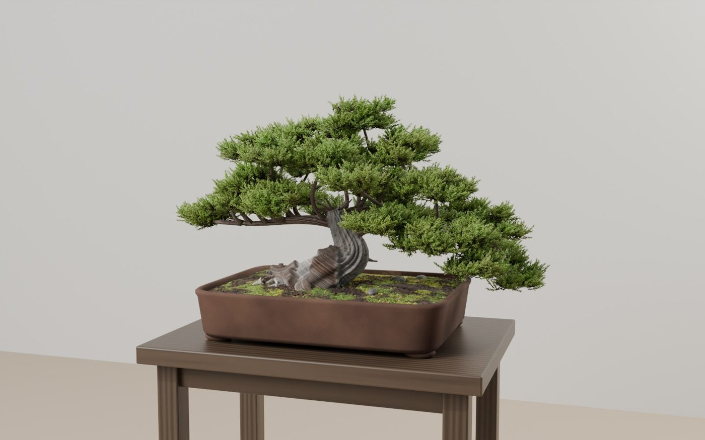
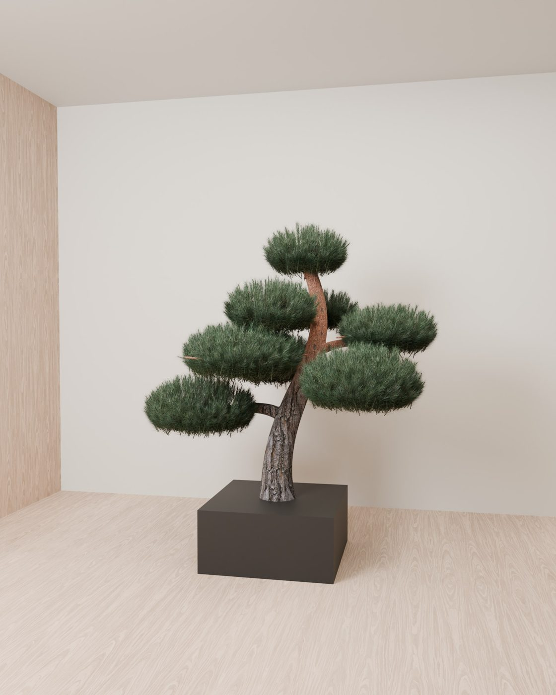
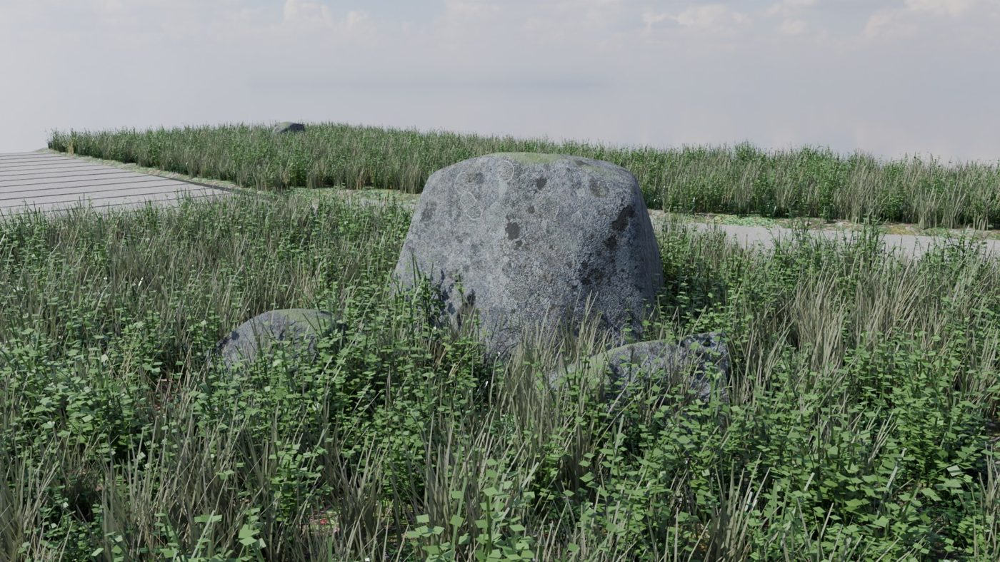
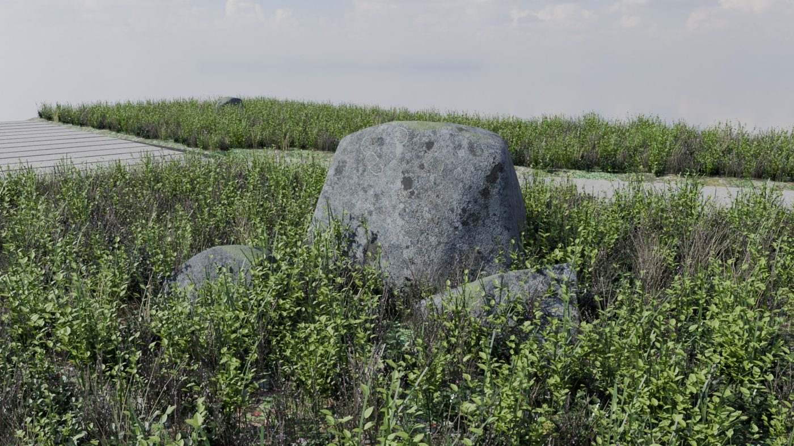
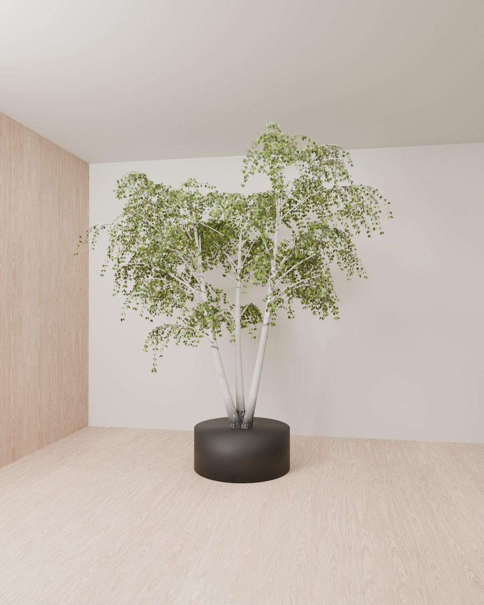
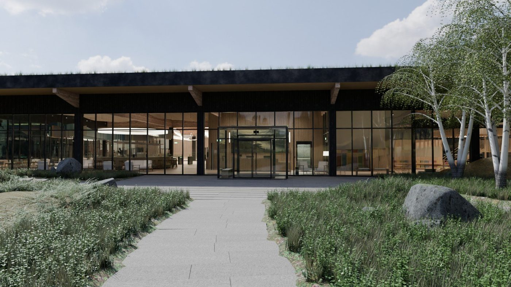

# photoreal-from-images

A Claude Code skill for photoreal plants, stones, ground covers and natural materials in Blender / Cycles, from
[The Gym](https://github.com/RomanSlack/the_gym), a fully generated Nordic gym building.

**The rule: realism comes from images, structure comes from code.** Leaves, bark, lichen and ground are generated reference
photos (cut-out leaf cards, tileable textures with height maps); shapes and placement are procedural Python, so every plant
and stone is unique. Each element is checked in a 30-second studio render before it goes into the full scene.

| | |
| --- | --- |
|  |  |
|  |  |
|  |  |

## Install

```bash
git clone https://github.com/RomanSlack/photoreal-from-images ~/.claude/skills/photoreal-from-images
pip install numpy opencv-python
```

Then ask Claude Code for realistic plants / stones / materials in a Blender scene; the skill loads itself.
Read [SKILL.md](SKILL.md) for the method, the gotchas, and **why it costs so little** (local GPU rendering, generators
instead of tokens, ~$15 of image API for the whole project).

## Scripts

- `scripts/leaf_cutout.py OUT_DIR leaf*.webp [--solid] [--delight] [--keep-stem]`: generated leaf photos to RGBA cards + bump + atlas.json
- `scripts/make_tileable.py SRC OUT_PREFIX [--px 4096]`: a generated surface photo to a tileable colour + height map

MIT licensed.
